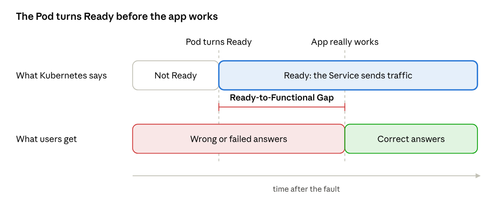
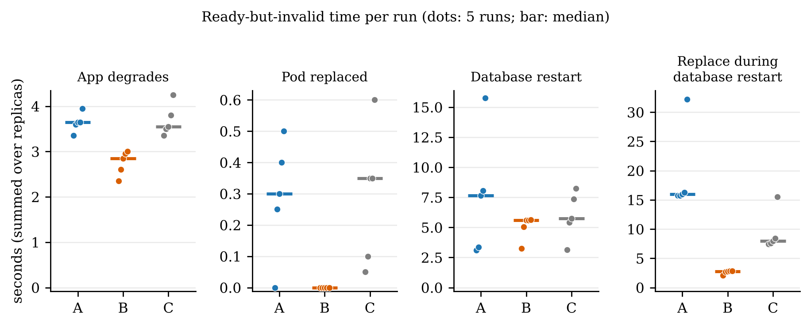
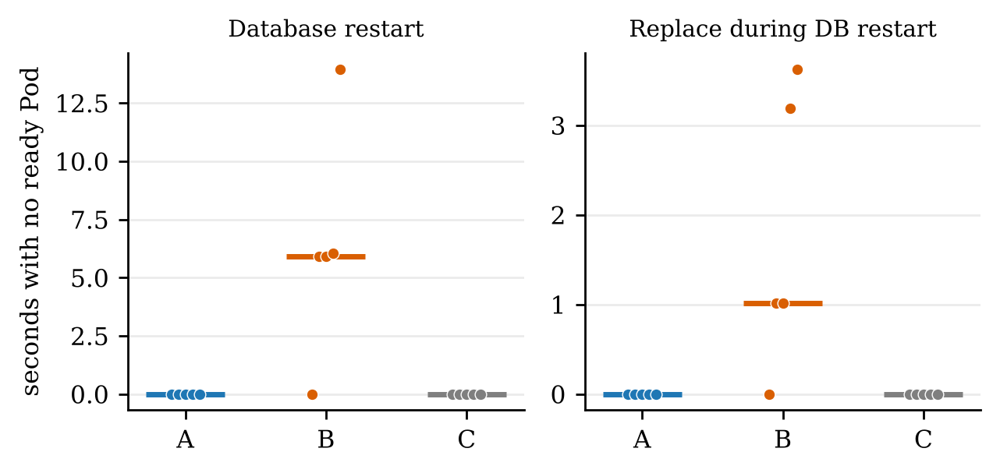
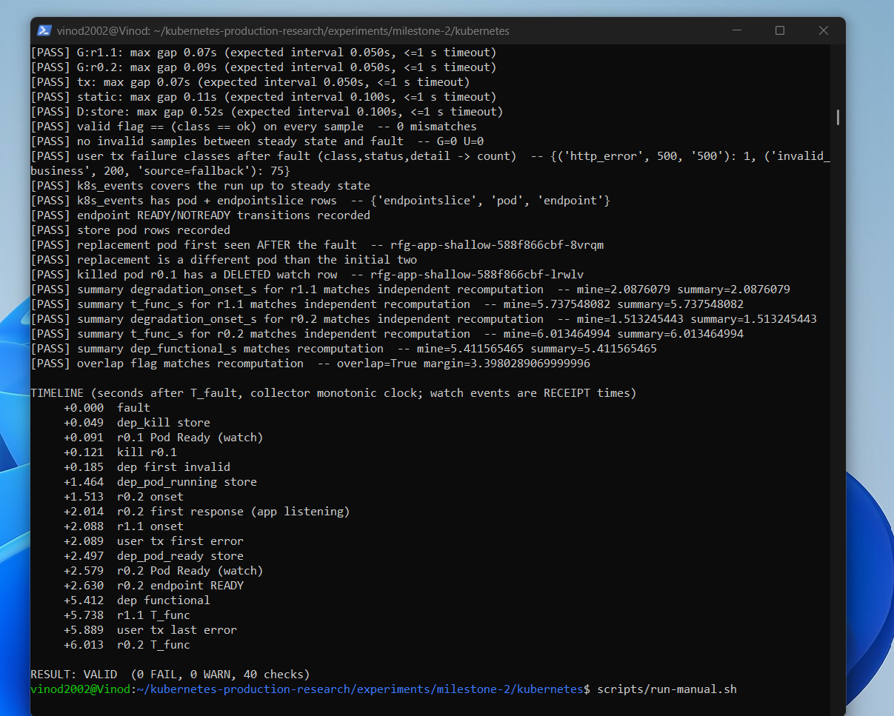

<h1 align="center">Kubernetes Ready-to-Functional Gap (RFG)</h1>

<p align="center">
<b>Kubernetes says "Ready". Is your app actually working?</b><br>
A fault-injection study on a real multi-node cluster.
</p>

<p align="center">


</p>

---

## The problem

A Pod is **Ready** when its readiness probe passes, and then the Service sends it traffic. But "probe passed" does not mean
"the application answers correctly". The time a Pod spends **Ready but not yet functional** is the
**Ready-to-Functional Gap (RFG)**.

<p align="center"></p>

This repository measures the gap on a **real three-node kind cluster** (Kubernetes 1.31) with fault injection, and compares:

| Setup | Readiness probe checks |
|---|---|
| **A, shallow** | the app process answers |
| **B, deep** | the app, the database, and a warm cache |
| **C, shallow + observer** | same as A, plus an external observer that only watches and never changes readiness |

Four faults: application degrades, Pod replaced, database restart, Pod replaced during a database restart.
4 faults x 3 setups x 5 repetitions = **60 runs**.

## Key findings

> **Pilot study.** Five runs per condition on one laptop. Medians and ranges only, no significance tests. Read these as directions, not proof.

| Finding | Evidence (medians of 5 runs) |
|---|---|
| The gap is real | Pods stayed Ready while failing for **3.6 s** (app degraded) up to **16 s** (replace during DB restart, two replicas summed) with a shallow probe |
| Failures hide from status codes | Bad replies were **HTTP 200 with wrong content** (e.g. 75 invalid replies vs at most 1 HTTP error in a DB restart) |
| A deep probe is a trade-off | Lowest Ready-but-invalid time in every scenario, **but** in a DB restart both replicas left the Service for **5.9 s**, and static pages failed too |
| A passive observer works | Loss detected in **0.05-0.15 s**, recovery declared 30/30, **0** false declarations, readiness untouched |
| My simulation was wrong in sign | Simulation: no gap for Pod replacement. Real cluster: small positive gap (0.08-0.62 s) in **9 of 10** runs |

<p align="center"></p>
<p align="center"><sub>Ready-but-invalid time per run (dots) and median (bar). Arms A and C use the same probe, yet differ by about 8 s in the last panel: that is the noise level of a five-run pilot.</sub></p>

<p align="center"></p>
<p align="center"><sub>Time with no ready Pod behind the Service. Only the deep probe (B) produced non-zero values.</sub></p>

## How it was measured

Three request streams run while a fault is injected:

- **Ground truth:** requests straight to each Pod at 20 Hz. A Pod is *functional* when it starts answering correctly and keeps doing so (at least 20 valid samples over at least 1 s).
- **User traffic:** requests through the Service, like a real user.
- **Dependency ping:** 10 Hz, to see when the database is really back.

A **separate validator** recomputes every run from the raw CSV files (31-36 checks per run). **59 of 60 runs passed**; the one flagged run is kept in the data and explained in the paper.

<p align="center"></p>
<p align="center"><sub>Validator output and event timeline of one manual test run (not pilot data).</sub></p>

## Repository layout

| Path | Contents |
|---|---|
| [`paper/`](paper) | Paper source (`main.tex`, Overleaf-ready), [`paper.pdf`](paper/paper.pdf), figures and terminal screenshots |
| [`data/pilot-20261109/`](data/pilot-20261109) | 60 per-run summaries, `aggregate.md` / `aggregate.csv`, validation log |
| [`experiments/milestone-2/kubernetes/`](experiments/milestone-2/kubernetes) | Real-cluster harness: app, store, collector, manifests, scripts, validator, tests |
| [`experiments/milestone-1/`](experiments/milestone-1) | Earlier local simulation (kept separate from real measurements) |
| [`reports/`](reports) | Result reports for milestones 1 and 2-A |
| [`research/`](research), [`evidence/`](evidence) | Initial investigation notes and evidence registers |
| [`docs/`](docs) | Images and article material |

## Reproduce

Needs Docker, `kind` and `kubectl` (at least 4 CPUs and 8 GiB RAM recommended; on Windows use WSL 2 with Docker Desktop).

```bash
cd experiments/milestone-2/kubernetes
scripts/preflight.sh          # read-only environment checks
scripts/build-images.sh       # builds rfg-app / rfg-store / rfg-collector
scripts/create-cluster.sh     # 3-node kind cluster + deploy
scripts/run-manual.sh         # one manual run first, inspect it by hand
RUN_NAME=my-pilot scripts/run-pilot.sh   # 60 runs (the original pilot took under 30 minutes)
scripts/analyze.sh my-pilot   # aggregate tables
scripts/teardown.sh
```

Measurement definitions, deviations from the simulation and known limits are in the
[harness README](experiments/milestone-2/kubernetes/README.md).

## Limits (please read)

- Small sample: 5 runs per cell, no statistical tests.
- One laptop, kind nodes as containers, a small two-replica app, one probe setting (1 s period, failure threshold 3), injected faults, Kubernetes 1.31.
- In 43 of 60 runs the first user request failed before measurement began; the cause is unexplained.
- Kube-proxy programming latency and probe CPU cost were not measured. The 10 s probe-period sweep was not run.

## Cite / contact

Vinod Ravindu Perera. *Measuring the Ready-to-Functional Gap in Kubernetes: A Fault-Injection Pilot Study on a Multi-Node Cluster.* 2026. Pilot study; see [`paper/paper.pdf`](paper/paper.pdf).

[LinkedIn](https://linkedin.com/in/vinod-perera-a2136131a) | [Medium](https://medium.com/@bamunuge2002) | [GitHub](https://github.com/Perera1325)

## License

MIT, see [`LICENSE`](LICENSE).
